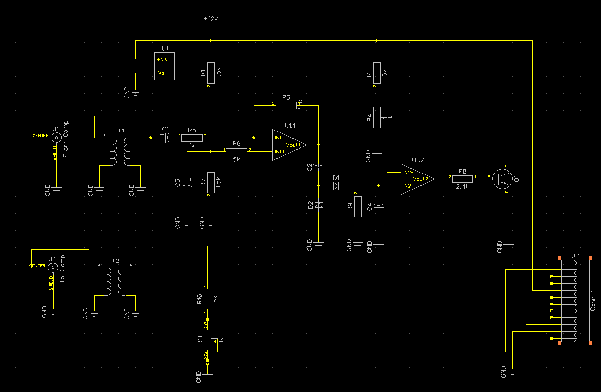
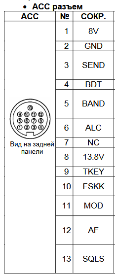
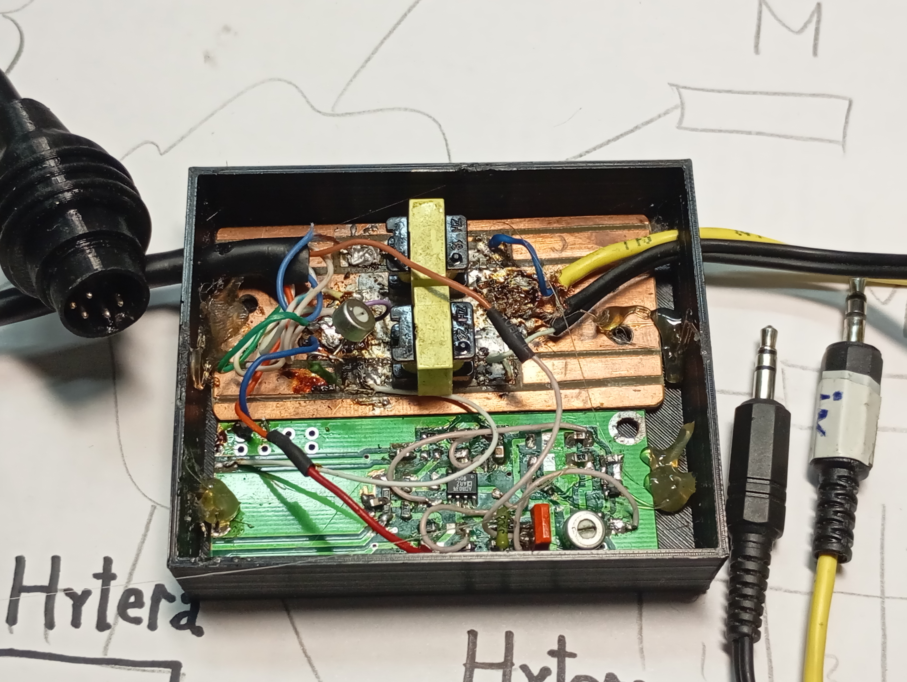

====================================================
     FT8 TEXT LINK AUTO - QUICK START USER MANUAL
====================================================

[ENG] IMPORTANT: The software operates using TWO windows simultaneously. Both must remain open.
The Sound Server utility launches automatically whenever you start the main program ("ft8-group.exe").

--- AUDIO SERVER CONFIGURATION ---

1. INPUT DEVICE SELECTION (Label 1 on screenshot):
   Click the drop-down menu and select your active hardware Audio Input / Microphone / Radio Line-In.

2. INPUT LEVEL ADJUSTMENT (Label 2 on screenshot):
   While receiving signals from your transceiver, adjust the vertical slider.
   The volume/signal level should be configured so that the indicator bar fills ALMOST TO THE TOP. 
   Proper gain staging is critical for decoding weak signals down to -20 dB SNR.

--- AUDIO OUTPUT & NODE ROLE CONFIGURATION ---

1. OUTPUT DEVICE SELECTION (Label 1 on screenshot):
   Click the drop-down menu and select "Динамики" (Speakers). 
   If "Динамики" is not available in your system, select "Наушники" (Headphones).

2. OUTPUT LEVEL ADJUSTMENT (Label 2 on screenshot):
   Use the slider to adjust the outgoing signal level during transmission.
   The volume must be set so that the indicator bar fills ALMOST TO THE TOP 
   to ensure proper modulation depth without clipping the radio transmitter.

3. NODE ROLE SELECTION (Режим рации):
   Select the operational mode for this specific station:
   * Main Node (Главный) — There can be ONLY ONE Master station per network. 
     Its hardcoded ID is 0 (e.g., "Штаб МЧС").
   * Subordinate Node (Подчиненный) — Field stations. The network supports 
     up to 45 subordinate nodes. You can assign any ID from 1 to 45 in the box.

*Note for Users: In production releases, these network identity parameters (Node ID and Role) 
will be hard-coded and locked inside the hardware USB security dongle provided for each computer. 
The software will automatically configure itself based on the physical key inserted.*

--- TIME SLOT VISUALIZER & MESSAGING INTERFACE ---

1. TIME SLOT INDICATOR (The Circular Chart):
   This is a real-time 60-second clock visualizer divided into four 15-second sectors:
   * Sector 1 (Top-Right): Reserved for the Main (Master) Node transmissions.
   * Sectors 2, 3, 4: Allocated to Subordinate Node Groups (15 stations per group).

2. QUICK TEMPLATE BUTTON (Label 1 on screenshot - "PlayNew"):
   Clicking this button automatically fills the message field with a pre-configured 
   or default template string.

3. MESSAGE INPUT FIELD (Label 2 on screenshot):
   This is the main text area. You can type any message here using Cyrillic characters 
   (up to 35 characters displayed/processed per input block in this field view).
   * Note on the example text: Shows a typical civil defense alert layout 
     ("VNIMANIE.RESPUBLIKA TATARSTAN.OTBOJ ATAKI BPLA...").

4. TARGET RECIPIENT ID (Идентификатор кому сообщение):
   Enter the specific destination Node ID in this numeric box (e.g., enter "0" to route 
   the message directly to the Main Command Station).

5. SUBMIT BUTTON (Label 3 on screenshot - "Сообщение в буфер"):
   Click this button to push your prepared message into the system queue. 
   The protocol will automatically wait for your node's designated 15-second time slot 
   and transmit the encrypted payload over the air.

6. TRANSMISSION PROGRESS BAR (Зеленый индикатор):
   Shows the active transmission status during the 15-second burst window (optional visual aid).

--- TIME SYNCHRONIZATION & AIR-GAPPED FALLBACK ---

1. GENERAL REQUISITES:
   The FT8-based data link relies strictly on precise time synchronization across all nodes. 
   The error margin must be within 1.0 second. In standard setups, synchronization is 
   handled via external internet NTP time servers.

2. AIR-GAPPED RADIO SYNCHRONIZATION ("Синхронизация по радио"):
   If the internet is completely unavailable, the network can calibrate itself over the air.
   * Activation: Open the menu and select "Синхронизация по радио" (Radio Synchronization).
   * Execution: This option must be toggled on the Main (Master) Node and simultaneously 
     on the Subordinate Nodes (supports any number of field stations at once).
   * Automation: Once activated, the over-the-air clock alignment process runs fully automatically. 
     Upon successful calibration, the subordinate node will display a confirmation message.

3. CALIBRATION SCHEDULE:
   Currently, the automated synchronization window opens at the end of every minute. 
   In production versions, this interval will be extended (most likely to the end of each hour) 
   to optimize data channel throughput.

--- TRANSCEIVER HARDWARE INTERACTION & RADIO COMPATIBILITY ---

1. UNIVERSAL HARDWARE COMPATIBILITY:
   The software is completely hardware-agnostic and compatible with ANY HF, VHF, or UHF 
   radio transceiver that possesses standard analog audio interface lines (Microphone/Line-In 
   and Speaker/Line-Out) and a standard Push-To-Talk (PTT) line.

2. HARDWARE AUDIO-TRIGGERED PTT (UNIVERSAL VOX MODEM):
   No software-side CAT control or serial/COM port configurations are required. 
   Transmission is keyed entirely by an autonomous, external hardware VOX circuit 
   placed between the PC sound card and the radio's PTT line.
   * Operation: The moment the program outputs audio tones, the hardware circuit instantly 
     rectifies the audio voltage to trigger a switching transistor or optocoupler. This pulls 
     the radio's PTT line to Ground, forcing the transceiver into transmit mode. When the audio 
     stops, the radio automatically drops back to receive mode.

3. CONNECTION EXAMPLE (For example: Icom IC-718):
   The software works with any radio, but here is a specific example using the 13-pin ACC connector on an Icom IC-718 transceiver:
   * ACC Pin 11 (MOD)     -> Connects to PC Sound Card Line-Out (for transmit audio).
   * ACC Pin 12 (AF)      -> Connects to PC Sound Card Line-In (for receive audio).
   * ACC Pin 3 (PTT)      -> Connects to the Hardware VOX Switch Output (to key the radio).
   * ACC Pin 8 (13.8V)    -> Connects to the VOX Circuit Power Input (powers the modem directly from the radio).
   * ACC Pin 2 (GND)      -> Common Ground.

### Hardware Reference Diagrams (IC-718 Example):

